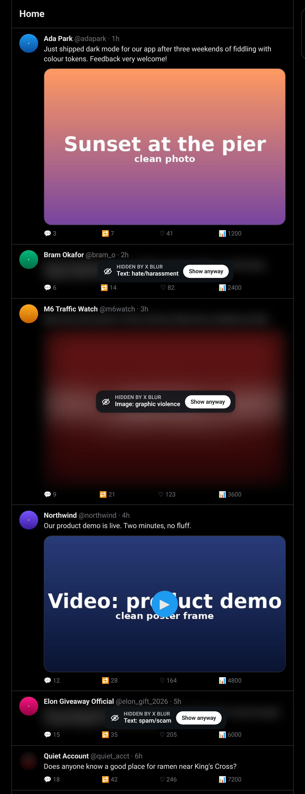

# X Blur

A Chrome extension that blurs inappropriate posts, replies, images, video thumbnails and profile pictures on X (x.com and twitter.com). Each post is judged by a classifier you choose, using your own API key:

- **TypeSafe Jev** (default): one calibrated yes/no probability per category.
- **xAI Grok** (alternative): an LLM verdict with a short reason, plus a vision model for images.

Flagged posts get blurred with a small label naming what was flagged (for example `Text: hate/harassment` or `Image: graphic violence`) and a **Show anyway** button. **Hide again** puts the blur back. Clean posts are left alone.



Inspired by [in-other-words](https://github.com/og2701/in-other-words), which does something similar for LinkedIn. X Blur is its own code with the same overall shape.

## Categories

| Category | Text | Images / video thumbnails / profile pictures |
| --- | --- | --- |
| hate/harassment | attacks, threats, bullying, dehumanising a group | hate symbols, hateful imagery |
| slurs | slurs, even partly censored | slurs written in the picture |
| sexual/explicit | explicit sexual content, porn promotion | nudity, sexual activity |
| graphic violence | vivid gore, glorified violence, calls to violence | blood, wounds, gore, dead bodies |
| self-harm | encouraging, instructing or glorifying self-harm | self-inflicted injuries |
| spam/scam | crypto giveaways, fake investments, phishing | scam adverts |

Each category can be switched off in the settings.

## Install (load unpacked)

1. Download or clone this repo, or unzip `release/x-blur-v*.zip`.
2. Open `chrome://extensions` and turn on **Developer mode**.
3. Click **Load unpacked** and pick the `extension/` folder (or the unzipped `x-blur-v*` folder).
4. The settings page opens. Paste a key, click **Save and test**, then open x.com.

No build step and no dependencies. Plain JavaScript, Manifest V3, Chrome 116 or newer.

## Getting a key

- **TypeSafe (default):** sign up at [console.typesafe.ai](https://console.typesafe.ai) and create an API key. The default model is `jev-1.14.0`. You can also pick `jev-latest`, `jev-preview` or `jev-1.13.0`.
- **xAI Grok:** create a key at [console.x.ai](https://console.x.ai). The default model is `grok-4.20-non-reasoning` (fast, accepts images, supports structured output). You can type any other model name, but it needs to accept images if you check media.

**Images are experimental on Jev.** TypeSafe calls image input "dreamer-ready" (since 14 Oct 2026). X Blur sends the `TypeSafe-Danger-Zone-Images: true` header, and the request format or accuracy may change. TypeSafe says Jev is weaker on images than on text, so X Blur asks one simple yes/no question per category rather than a single broad one. If image results are poor, turn images off or switch to Grok for media.

## Settings

- **Classifier:** Jev or Grok, with each one's key and model.
- **Strictness:** a post is blurred when an enabled category's probability is at or above this threshold (default 0.70). For Jev that is the Noul probability, which TypeSafe trains to be calibrated. For Grok it is Grok's self-reported confidence, which is less well calibrated.
- **What to check:** post text, post images, video thumbnails, profile pictures, and replies on post pages.
- **Categories:** turn any category on or off.
- **Clear cache:** forgets saved verdicts.

The toolbar popup has an on/off switch and counts for the current page: posts checked, posts blurred, images and videos blurred, and profile pictures blurred.

## How it works

```
content.js (x.com tab)                 background.js (service worker)
  IntersectionObserver + Mutation-  -> check-text {text}           -> cache hit? answer
  Observer find posts near the         check-media {url, kind}        else Jev or Grok
  viewport                                                            (keys live here only)
  blur / label / Show anyway       <- {decision, label}            <- scores per category
```

- **Finding posts:** `article[data-testid="tweet"]` is watched as it nears the viewport. X's virtualised infinite scroll recycles and rebuilds articles, so each one is re-read when its contents change. Route changes in the single-page app are picked up through history and URL polling.
- **What gets sent:** only the post text (`tweetText`, including a quoted post's text) and the image URLs. Usernames, handles, display names and account details are never sent. The worker fetches each image from `pbs.twimg.com` itself, asking for a small JPEG (`?format=jpg&name=small`, and `_400x400` for avatars), and sends the bytes to the classifier.
- **Jev:** one request per post. The post is the `state`, with six Noul questions, one per category. Images are one request each, sent as `multipart/form-data`: the JSON goes first as `request`, and the image is its own part, listed once in `assets` and referenced from `state`. Images that fall outside Jev's 280 to 1568 px limits are padded or shrunk with `OffscreenCanvas`.
- **Grok:** posts arriving within 150 ms are batched (up to 8 per request) into chat completions at `https://api.x.ai/v1/chat/completions` with a strict JSON schema: `{id, inappropriate, categories[], confidence, reason}`. Images are sent one per request as a data URL.
- **Deciding:** each category's score is compared with the threshold and the category toggles. A post is hidden if its text or any of its media is flagged. Flagged media also stays blurred on its own after **Show anyway**, with its own Show button. A flagged profile picture is blurred on its own and does not hide the post.
- **Caching:** verdicts (scores only, never text or image bytes) go in `chrome.storage.local`, keyed by provider, model and a SHA-256 of the normalised text, or of the image URL for media. Changing the threshold or categories re-decides instantly from the cache. Up to 5,000 verdicts are kept.
- **Errors fail open:** timeouts, network errors, rate limits (`429` with `retry-after` backoff, then a 30 s pause) and bad answers never blur anything. A rejected key shows a `!` on the toolbar badge and a note in the popup.

## Privacy

- API keys are stored in `chrome.storage.local`. They are not synced, and content scripts can't read them (the storage area is set to trusted contexts only). Each key is only sent to its own provider.
- Post text, and image bytes for the media types you enable, go to the provider you picked (TypeSafe or xAI) and nowhere else. See their privacy policies for how they handle requests.
- Nothing is sent for posts you never scroll near. Nothing is sent while the extension is switched off.
- Only verdict scores are stored locally.

## Cost (estimate)

These figures come from `npm run estimate`, which builds the real requests for the sample posts and assumes about 4 characters per token. **They are estimates, not quotes.** Image token counts are an assumption (about 1,000 tokens per small JPEG), because TypeSafe has not published how it counts image tokens yet.

| | Per 1,000 posts / images (estimate) |
| --- | --- |
| Jev text (~525 input tokens, output free, $0.042 / M) | ~$0.02 |
| Jev images (~1,400 input tokens assumed) | ~$0.06 |
| Grok text, batched (~86 in + 45 out tokens, $1.25 / $2.50 per M) | ~$0.22 |
| Grok images (~1,500 in tokens assumed) | ~$2.00 |

A heavy day of scrolling (2,000 posts, 800 images, 300 new avatars) comes to roughly $0.10 with Jev, or $2.70 or so with Grok. Cached posts cost nothing.

## When X changes its markup

Every selector lives in one `SELECTORS` object at the top of `extension/content.js`:

```js
const SELECTORS = {
  tweet: 'article[data-testid="tweet"]',
  focalTweet: 'article[data-testid="tweet"][tabindex="-1"]',
  tweetText: 'div[data-testid="tweetText"]',
  photo: 'div[data-testid="tweetPhoto"]',
  video: 'div[data-testid="videoPlayer"]',
  avatar: 'div[data-testid="Tweet-User-Avatar"]',
  ...
};
```

If posts stop being picked up, open DevTools on x.com, inspect a post, and update the matching `data-testid`. Then update `test/feed.mjs` so the mock feed matches and run `npm run e2e`. The blur CSS in `content.css` uses the same `data-testid` hooks.

## Development

```sh
npm install              # playwright-core, only for the e2e test
npx playwright-core install chromium
npm test                 # unit tests (node:test)
npm run e2e              # loads the extension in Chromium against a mock X feed
npm run estimate         # cost estimate from request sizes
npm run build            # release/x-blur-v<version>.zip (+ .sha256)
python3 scripts/make-art.py   # redraw icons and test images
```

The e2e test serves `test/feed.mjs` at `https://x.com/home`. It mocks `pbs.twimg.com` with the images in `test/fixtures/`, and mocks both the TypeSafe and xAI APIs. It runs once per provider, scrolls through infinite scroll and recycling, and checks that flagged text, images, video thumbnails and avatars are blurred while clean ones are untouched. It also checks that rebuilt posts are answered from the cache, that Show anyway / Hide again work, that API errors fail open, that the replies toggle works after SPA navigation, that turning the extension off removes all blurs, and that Save and test works. Screenshots go to `test/results/`.

## Known limitations

- The classifier makes mistakes in both directions. Jev's image support is experimental.
- Text is judged without the thread around it, so replies that are only abusive in context can be missed.
- Videos are judged by their poster frame only. GIFs and link-card images are not checked yet.
- A post is shown normally until its verdict arrives, usually well under a second, before it scrolls into view.
- X changes its markup often, so selectors may need updating (see above).

## Licence

MIT. See [LICENSE](LICENSE).
